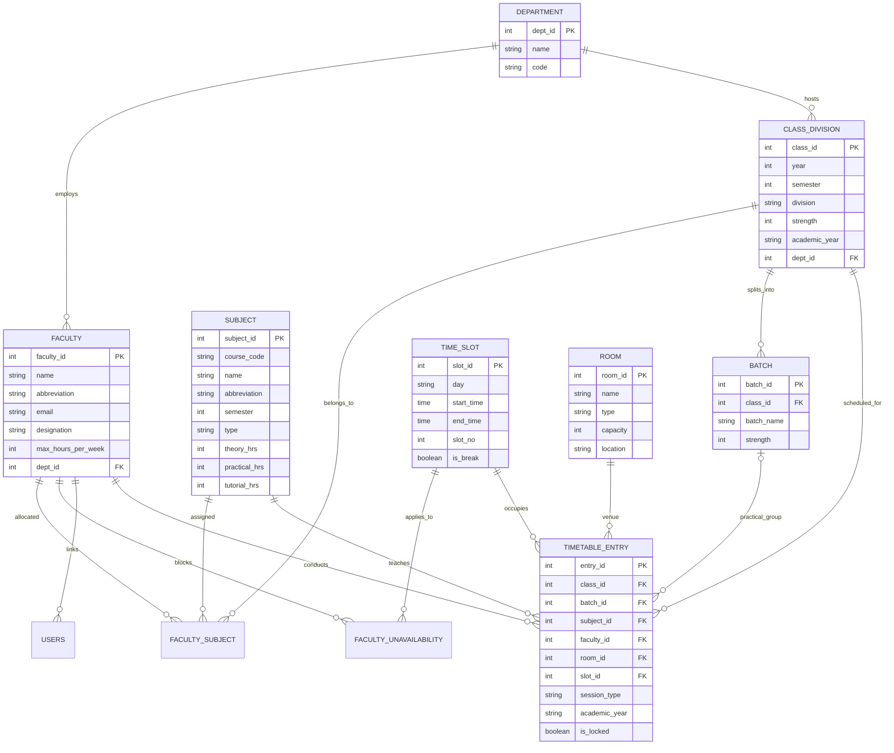

# ECS Faculty Timetable Generator & Conflict Detection System

**Fr. Conceicao Rodrigues College of Engineering (FrCRCE), Bandra, Mumbai**  
*Department of Electronics and Computer Science (ECS)*

An enterprise-grade, desktop-based academic timetable management and auto-generation application built in pure Java (JDK 17+) and Swing, backed by a normalized 3NF MySQL relational database with plain JDBC connectivity.

---

## Table of Contents
1. [Overview & Highlights](#overview--highlights)
2. [Architecture & Technology Stack](#architecture--technology-stack)
3. [Database Schema & ER Diagram](#database-schema--er-diagram)
4. [Scheduling Engine & Conflict Resolution](#scheduling-engine--conflict-resolution)
5. [Prerequisites & Database Setup](#prerequisites--database-setup)
6. [Compilation & Execution](#compilation--execution)
7. [Default User Credentials](#default-user-credentials)
8. [Academic Context & Seed Data](#academic-context--seed-data)
9. [Feature Walkthrough](#feature-walkthrough)
10. [Automated Verification & Tests](#automated-verification--tests)

---

## Overview & Highlights

- **Pure Java (JDK 17+)**: Zero web frameworks, zero Spring, zero Hibernate.
- **Modern Desktop UI**: Java Swing with FlatLaf modern UI theme (automatic fallback to built-in Nimbus Look and Feel). Responsive asynchronous execution using `SwingWorker` so the GUI never freezes.
- **Relational 3NF MySQL**: Fully normalized database with foreign key constraints, composite unique indexes preventing double-booking at DBMS level, SQL views, triggers, and stored procedures.
- **Plain JDBC DAO**: 100% `PreparedStatement` with connection pooling (`DBConnection.java`), zero ORM, and safe transactions (`commit`/`rollback`).
- **Scheduling Engine**: Backtracking with constraint propagation (most-constrained-first ordering: lab blocks first, then tutorials, then theory), accompanied by heuristic soft-constraint scoring and greedy local-search fallback.
- **Manual Clash Validation**: Move/swap timetable entries with immediate real-time clash diagnosis.
- **Reports & Exporting**: Workload report, unplaced conflict diagnostics, weekly color-coded grid viewer (by Class, Faculty, or Room), CSV export, and Swing printing.

---

## Architecture & Technology Stack

The project follows a clean **Layered MVC / DAO Architecture**:

```
in.frcce.ecs/
├── model/           # Plain Old Java Objects (12 POJOs)
│   ├── Department, Faculty, Subject, ClassDivision, Batch
│   ├── Room, TimeSlot, FacultySubject, FacultyUnavailability
│   ├── TimetableEntry, User, ConflictReport
├── dao/             # Plain JDBC Data Access Objects (10 DAOs, PreparedStatements)
│   ├── FacultyDAO, SubjectDAO, ClassDivisionDAO, BatchDAO, RoomDAO
│   ├── TimeSlotDAO, FacultySubjectDAO, FacultyUnavailabilityDAO
│   ├── TimetableEntryDAO, UserDAO
├── service/         # Business logic and pure Java scheduling engine
│   ├── AuthService, SchedulingState, ScheduleTask, TimetableService
├── ui/              # Swing Desktop UI & Panels
│   ├── LoginFrame, MainFrame, TimetableViewPanel, EditEntryDialog
│   ├── FacultyPanel, SubjectPanel, ClassPanel, RoomPanel, TimeSlotPanel
│   ├── AllocationPanel, UnavailabilityPanel, ConflictReportPanel, WorkloadReportPanel
└── util/            # Connection pooling, password hashing, exporting
    ├── DBConnection, PasswordUtil, ExportUtil
```

---

## Database Schema & ER Diagram

The database schema (`sql/schema.sql`) enforces integrity at the relational level:
- **Hard Clashes Prevented by Database Constraints**:
  - `uq_faculty_slot (faculty_id, slot_id, academic_year)`: Prevents faculty double-booking.
  - `uq_class_slot (class_id, slot_id, academic_year)`: Prevents a class from having two overlapping sessions.
  - `uq_room_slot (room_id, slot_id, academic_year)`: Prevents room collision.
- **Trigger**: `trg_check_faculty_max_hours` raises SQLSTATE 45000 if an insert causes faculty to exceed `max_hours_per_week`.
- **Stored Procedure**: `sp_faculty_workload(faculty_id, academic_year)` returns both workload breakdown and available free slots.
- **Views**: `vw_class_timetable`, `vw_faculty_timetable`, `vw_room_timetable`, `vw_faculty_workload`.

### Entity-Relationship Diagram (Mermaid)



---

## Scheduling Engine & Conflict Resolution

### Constraints Handled
1. **Hard Constraints (Zero Tolerance)**:
   - **Faculty Uniqueness**: A faculty cannot be scheduled in two locations in the same slot.
   - **Class Division / Batch Uniqueness**: A division or batch cannot attend two overlapping lectures.
   - **Room Exclusivity**: A room or laboratory can only host one session per slot.
   - **Lab Continuity**: Practical lab blocks require **2 consecutive slots** in a `LAB`-type room and **never straddle** the morning short break or afternoon lunch break.
   - **Faculty Unavailability**: Slots marked as blocked by faculty are strictly bypassed.
   - **Room Capacity**: $RoomCapacity \ge ClassStrength$ (or batch strength for practicals).
   - **Faculty Max Hours**: Faculty workload cannot exceed their assigned weekly limit.

2. **Soft Constraints (Optimization Heuristic)**:
   - **Subject Distribution**: Prevents scheduling the same theory subject multiple times on the same day.
   - **Pedagogical Pacing**: Avoids scheduling more than 3 consecutive lectures for students.
   - **Afternoon Practicals**: Favors scheduling heavy laboratory practicals in afternoon sessions.
   - **Gap Minimization**: Tightly clusters morning lecture blocks to avoid idle student waiting time.

### Algorithm Flow
1. **Task Extraction**: Decomposes subjects and allocations into discrete `ScheduleTask` units.
2. **Heuristic Sorting (Most-Constrained First)**: 2-hour practical lab blocks are sorted before tutorials and theory.
3. **Backtracking with Constraint Propagation**:
   - The engine iterates through candidate slots and rooms.
   - In-memory `SchedulingState` bitsets test conflicts in $O(1)$ time.
   - Backtracking branch pruning unwinds assignments upon reaching a dead end.
4. **Greedy Local-Search Fallback**:
   - An asynchronous 15-second deadline guards the backtracking loop.
   - If a dead-end occurs under severe constraints, a greedy local-repair strategy places the remaining sessions and outputs detailed diagnostics for unplaced sessions to the `ConflictReportPanel`.
5. **Atomic Transaction Persistence**: The final clash-free schedule is written via JDBC in a single transaction with automatic rollback on error.

---

## Prerequisites & Database Setup

### 1. Requirements
- **Java**: JDK 17 or higher (tested on OpenJDK / Oracle JDK 17, 21, and 26).
- **MySQL**: MySQL 8.0+ server running on `localhost:3306`.
- **Build**: Maven 3.8+ (optional; project includes standalone compilation scripts).

### 2. Configure Database Credentials
Edit `src/main/resources/db.properties` with your MySQL credentials:
```properties
db.url=jdbc:mysql://localhost:3306/ecs_timetable?useSSL=false&allowPublicKeyRetrieval=true&serverTimezone=Asia/Kolkata&characterEncoding=utf8mb4
db.username=root
db.password=your_mysql_password
db.pool.min=2
db.pool.max=10
```

### 3. Initialize MySQL Database
Execute the schema and seed scripts using the MySQL client:
```bash
mysql -u root -p < sql/schema.sql
mysql -u root -p < sql/seed.sql
```

---

## Compilation & Execution

### Option A: Using Maven (Standard)
```bash
# Compile and run unit tests
mvn clean test

# Package fat executable JAR
mvn clean package

# Run application
java -jar target/ecs-timetable-generator-1.0.0.jar
```

### Option B: Using Provided Shell Scripts (No Maven Required)
```bash
# 1. Compile all source files
./compile.sh

# 2. Run automated clash detection test suite
./test.sh

# 3. Launch the Swing application
./run.sh
```

---

## Default User Credentials

| Username | Password | Role | Description |
|:---|:---|:---|:---|
| `admin` | `admin123` | **ADMIN** | Full administrative rights (generate, edit, CRUD master data) |
| `vvg` | `faculty123` | **FACULTY** | Prof. Vaibhav Godbole (ECS Timetable Coordinator / Class Teacher) |
| `sup` | `faculty123` | **FACULTY** | Dr. Sapna Prabhu |
| `dvb` | `faculty123` | **FACULTY** | Dr. D.V. Bhoir |
| `al` | `faculty123` | **FACULTY** | Prof. Archana Lopes |
| `ap` | `faculty123` | **FACULTY** | Prof. Annivilia Pereira |
| `dab` | `faculty123` | **FACULTY** | Dr. Dipak Bauskar |

*Note: All passwords in the database are stored as salted SHA-256 hex hashes.*

---

## Academic Context & Seed Data

The seed dataset is modeled directly on the **Fr. Conceicao Rodrigues College of Engineering (FrCRCE)** S.E. ECS timetable:

- **Class**: S.E. ECS (Semester III & IV, Division A), Room 307
- **Class Teacher**: Prof. Vaibhav Godbole (VVG)
- **Time Slots**:
  - `08:45 - 09:45`: Slot 1
  - `09:45 - 10:45`: Slot 2
  - `10:45 - 11:00`: *Short Break*
  - `11:00 - 12:00`: Slot 4
  - `12:00 - 13:00`: Slot 5
  - `13:00 - 13:30`: *Lunch Break*
  - `13:30 - 14:30`: Slot 7
  - `14:30 - 15:30`: Slot 8
  - `15:30 - 16:30`: Slot 9
- **Laboratories & Rooms**:
  - Classrooms: Room 307, 308, 309, 310
  - Labs: ECS Lab 1, ECS Lab 2, Computer Lab 1 & 2, Electronics Lab 1 & 2
- **Semester III Curriculum**:
  - `25PCC12EC01`: Electronic Devices and Applications (EDA) — 2 TH + 2 PR (Dr. D.V. Bhoir)
  - `25PCC12EC02`: Computer Organization and Architecture (COA) — 2 TH + 2 PR (Dr. Sapna Prabhu / Prof. K. Rodrigues)
  - `25PCC12EC03`: Database Management System (DBMS) — 2 TH + 2 PR (Prof. Vaibhav Godbole)
  - `25PCC12EC04`: Object Oriented Programming with JAVA (OOPJ) — 2 PR (Prof. Archana Lopes)
  - `25OE312EC01`: Law for Engineers (LE) — 2 TH (Prof. I. Khan)
  - `25OE312EC02`: Financial Planning, Taxation & Investment (FPTI) — 2 TH (Prof. K. Rodrigues)
  - `25MDM12EC01`: MDM Course-1 Finance Accounting — 2 TH (Prof. Annivilia Pereira)
  - `25MDM12EC02`: MDM Course-2 Economics — 2 TH (Prof. Annivilia Pereira)
  - `25HSSM2EC01`: Modern Indian Language (MIL) — 2 TH (Prof. Riya D'Souza)
  - `25HSSM2EC02`: Human Values and Professional Ethics (HVPE) — 1 TH + 2 PR (Prof. Annivilia Pereira)
  - `25CEP12EC01`: Community Engagement Project (CEP) — 4 Project Hours (Prof. Vaibhav Godbole)
  - `25DM12EC01`: Double Minor Course (DM) — 2 TH (Dr. Dipak Bauskar)

---

## Feature Walkthrough

### 1. Login Screen
Secure authentication screen supporting Admin and Faculty roles, featuring SHA-256 password hashing.

### 2. Timetable Viewer (Weekly Grid)
- **Multi-Perspective Views**: Switch dynamically between **Class View**, **Faculty View**, and **Room View**.
- **Color Coding**: Visual distinction between Theory (blue), Practicals (green), Tutorials (orange), Breaks (grey), and Free slots.
- **Batched Parallel Labs**: Displays parallel batch rotations (Batches A, B, C, D) scheduled concurrently in different laboratories.
- **Export & Print**: One-click **Export to CSV** and standard **Print-friendly layout** using Java Swing Print API.

### 3. Timetable Generation (`SwingWorker`)
Clicking **Generate** triggers the pure Java scheduling engine on a background worker thread with a live progress dialog, keeping the UI interactive.

### 4. Conflict Detection & Manual Editing
- Double-clicking or right-clicking any timetable entry opens the `EditEntryDialog`.
- If an admin attempts to move a lecture to an occupied slot, the system flags the specific constraint:
  - *"Faculty is already assigned to another session in this slot."*
  - *"This class already has a session in the selected slot."*
  - *"Room is already in use in the selected slot."*
  - *"Faculty has marked this slot as unavailable."*

### 5. Master Data CRUD Screens
Dedicated tabbed management interfaces for:
- **Faculty**: Add/edit faculty, adjust weekly workload limits, toggle active status.
- **Subjects**: Configure course codes, types, and theory/practical/tutorial hour allocations.
- **Classes & Batches**: Configure student divisions and sub-batches (e.g. A, B, C, D).
- **Rooms**: Define classrooms and specialized hardware/software labs with capacity limits.
- **Time Slots**: Manage daily timing, breaks, and slot ordering.
- **Allocations**: Link faculty members to specific subjects and session types.
- **Faculty Unavailability**: Allow faculty to block time slots for meetings, research, or leaves.

### 6. Conflict & Workload Reports
- **Conflict Diagnostics**: Detailed analysis of unplaced sessions.
- **Faculty Workload**: View total scheduled hours vs. remaining capacity, with an interactive free-slot locator.

---

## Automated Verification & Tests

The project includes both JUnit 5 test classes (`ClashDetectionTest.java`) and zero-dependency standalone test suites (`StandaloneClashTest.java` and `SeedDataSchedulingTest.java`).

Run the automated verification suite anytime:
```bash
./test.sh
```

**Verification Results Output**:
```
=============================================================
1. Running Standalone Clash Detection Hard-Constraint Suite:
=============================================================
  [PASS] Faculty initially free
  [PASS] Faculty blocked in same slot (Double-booking prevention)
  [PASS] Faculty still available in another slot
  [PASS] Class initially free
  [PASS] Class busy in same slot (No overlapping class sessions)
  [PASS] Room initially free
  [PASS] Room busy in same slot (No double-booking rooms)
  [PASS] Faculty blocked when marked unavailable
  [PASS] Faculty available in unblocked slots
  [PASS] Occupied slot correctly blocked
  [PASS] Releasing restores faculty availability
  [PASS] Releasing restores class availability
  [PASS] Releasing restores room availability
  [PASS] Initial faculty sessions is 0
  [PASS] Faculty session count updated to 2
  [PASS] Consecutive session count detected as 2
Test Results: 16 passed, 0 failed

=============================================================
2. Running FrCRCE SE-ECS Seed Data Scheduling Engine Test:
=============================================================
Total sessions to schedule: 26
Placed: 26 / 26 sessions
Total entries in generated timetable: 33

Checking constraints on generated timetable:
  [SUCCESS] All constraints satisfied with ZERO CLASHES!
```
